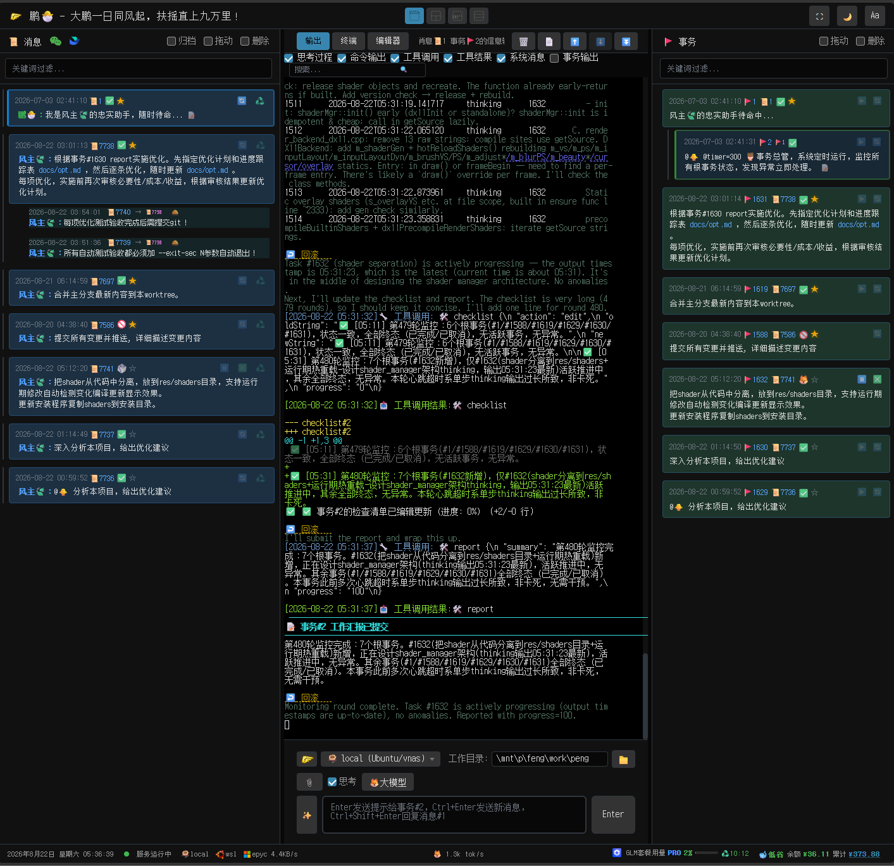

# 鹏🐣 (Peng)

### 大鹏一日同风起，扶摇直上九万里
---

## 简介

**鹏🐣** 是一个**AI 开发助手**。

- 运行 bin/fly install 一键安装，设置大模型API，即可开始工作。（ WebUI默认端口：6688 ）
- 消息与事务分离，树状结构，PostgreSQL数据库管理
- 通过事务清单（checklist）管理大模型短期记忆，不依赖上下文压缩
- WebUI界面：消息树，事务树，大模型输出，终端，编辑器
- cli命令行：消息管理：bin/msg；事务管理：bin/task；服务管理：bin/fly；远端管理：bin/nest
- 鹏窝（nest），远端开发。远端运行 bin/nest install --host x.x.x.x 即可依赖相对少，适合弱机。支持多个远端协作
- 自动备份（临时目录+git）支持回滚。崩溃自恢复
- 支持AGENTs.md，skills，hooks
- 多API自动轮询，无缝切换
- 事务通知（info）机制，大模型运行期消息/通知处理。
- 支持功能性tag。（定时器：@timer=300；上下文长短控制：@max=128K；事务依赖：@wait#23；指定大模型API：@🐥；指定远端：@nest=wsl；指定工作目录：@workdir=/tmp）
- json配置，目录config/
- 本项目由鹏🐣（本项目）辅助开发完成。

